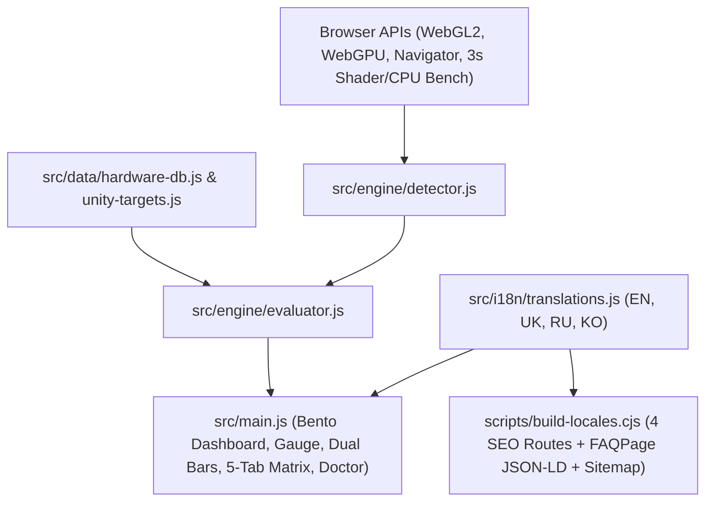

# Can I Run Unity? (`canirunUnity`)

**Can I Run Unity?** is a zero-upload, in-browser hardware compatibility analyzer, FPS/compile estimator, and Local AI readiness checker for **Unity Engine** (`Unity 6`, `2022.3 LTS`, `URP`, `HDRP`, `OpenXR / PICO`, `Sentis`, and local `Ollama / Qwen-Coder` LLMs running alongside Unity Editor).

Modeled after `canirun.ai` and styled in the **Cloud Dancer Bento** design system of [sivochka.com](https://sivochka.com/) (`figarist.github.io`) with a **Unity Pro Dark** toggle.

- **🌐 Live App:** [sivochka.com/canirunUnity/](https://sivochka.com/canirunUnity/) · [Українська (`/uk/`)](https://sivochka.com/canirunUnity/uk/) · [Русский (`/ru/`)](https://sivochka.com/canirunUnity/ru/) · [한국어 (`/ko/`)](https://sivochka.com/canirunUnity/ko/)
- **💻 GitHub:** [Figarist/canirunUnity](https://github.com/Figarist/canirunUnity)

---

## Key Features

- **100% Local Auto-Detection**: Probes `WebGL2` (`UNMASKED_RENDERER_WEBGL`), `WebGPU` (`adapter.info`), `navigator.hardwareConcurrency`, `navigator.deviceMemory`, and OS in-browser with zero telemetry uploads.
- **Smart RAM Heuristic**: Automatically infers realistic system RAM from your GPU tier when browsers cap `navigator.deviceMemory` at `8 GB` for privacy, with 1-click RAM/VRAM snap pills.
- **Optional 3-Second GPU/CPU Stress Test**: Runs an offscreen WebGL2 shader loop + C# AST/matrix CPU stress test to measure real fillrate and single-thread compute performance.
- **Unity Readiness Score (`0–100`) & Letter Grade (`S`–`F`)**: Evaluates 7 primary workflows (`2D/Mobile/Wear OS`, `3D Indie URP`, `Multiplayer/FPS`, `AAA HDRP`, `VR/XR`, `AI: Sentis/ML-Agents/Local LLM`, and `School/Starter`).
- **30+ Target Compatibility Matrix**: Filterable across `Unity Versions`, `Render & Lightmap`, `Packages & XR`, `AI & Local LLM`, and `IDEs & Tools` (including running `Qwen-Coder 3B–32B` alongside an open Unity Editor + IDE).
- **Dual RAM & VRAM Budget Bars + Upgrade Simulator**: Visualizes `OS + Unity + IDE` memory headroom and simulates score deltas (`+Δ pts`) for RAM, NVMe SSD, and GPU upgrades.
- **Unity Doctor & Spec Report**: Generates tailored Editor optimization tips and copies a clean hardware spec summary.
- **4-Language SEO & PWA**: Static localized HTML routes (`/`, `/uk/`, `/ru/`, `/ko/`) with `hreflang`, `sitemap.xml`, `Schema.org @graph` (`WebApplication` + `12-question FAQPage`, a static crawlable requirements section + `BreadcrumbList`), GoatCounter analytics, and offline Service Worker.

---

## Architecture



---

## Local Development & Commands

Requirements: **Node.js 20+**

```powershell
# Install dependencies
npm install

# Start local dev server (http://localhost:5173)
npm run dev

# Run deterministic unit & i18n regression tests
npm test

# Production build + 4-locale SEO generation + verification gate
npm run build
```

---

## Author (`Ihor Sivochka / Figarist`)

Created and maintained by **Ihor Sivochka (Ігор Сівочка / Figarist)**.

- 🌐 **Hub:** [sivochka.com](https://sivochka.com/)
- 💻 **GitHub:** [Figarist/canirunUnity](https://github.com/Figarist/canirunUnity)
